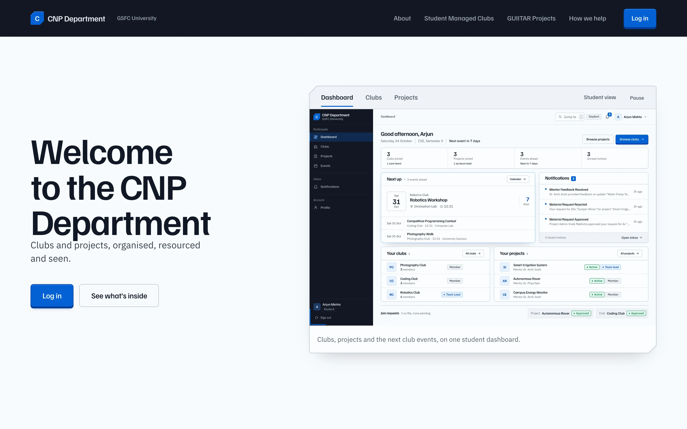

# CNP Department

**One place for the student-run clubs and incubation projects of GSFC University.**

CNP Department is the working home of two communities at GSFC University, Vadodara: the
**Student Managed Clubs** — interest groups planned, funded and led by students — and the
**GUIITAR Projects** — incubated hardware and software teams with mentorship, labs and
business support behind them. The public page explains both. Behind the login, every role
gets a different instrument: students track what they belong to, coordinators clear requests,
mentors follow their teams, administrators run the portfolio.

<p align="center">
  
</p>

<p align="center">
  <sub>The public front door: a staged product view in the hero, real club and project screens in the body.</sub>
</p>

---

## Contents

- [The five roles](#the-five-roles)
- [A tour](#a-tour)
- [The design system](#the-design-system--cobalt)
- [How it is built](#how-it-is-built)
- [Run it locally](#run-it-locally)
- [Routes](#routes)
- [The quality bar](#the-quality-bar)
- [Documentation](#documentation)

---

## The five roles

Five experiences, deliberately not one dashboard with swapped cards. Each role gets its own
information architecture, its own priorities and its own actions.

| Role | What they open the app for |
|---|---|
| **Student** | What am I in, what is next, what needs my attention |
| **Faculty coordinator** | The clubs I guide: members, join requests, events |
| **Faculty mentor** | The projects I mentor: teams, updates, feedback |
| **Club admin** | The health of the club programme: coverage, requests, events |
| **Project admin** | The operations desk: portfolio, materials, inventory, queues |

> **Team leader** is not a global role: it is a per-project assignment, shown as a tag on
> the project and in the member roster.

---

## A tour

### 01 · Five dashboards

The student screen leads with the next event as an object, then the clubs and projects they
belong to. The four staff screens each answer a different question.

<table>
<tr>
<td width="50%"><br/><sub><b>Student</b> — next up, membership, standing, inbox</sub></td>
<td width="50%"><br/><sub><b>Coordinator</b> — the clubs they guide, and the queue</sub></td>
</tr>
<tr>
<td><br/><sub><b>Club admin</b> — coverage of the whole programme</sub></td>
<td><br/><sub><b>Mentor</b> — a calm, read-mostly view of their teams</sub></td>
</tr>
<tr>
<td colspan="2"><br/><sub><b>Project admin</b> — a control room: portfolio, queues, inventory</sub></td>
</tr>
</table>

### 02 · Clubs

A directory that leads with one club, then gets out of the way. The detail page is the record:
the member list, the core-team split, the coordinator, the next event, and the administration
toolbar for the people who run it.

<table>
<tr>
<td width="50%"><br/><sub><b>Directory</b> — one lead club, ruled rows for the rest</sub></td>
<td width="50%"><br/><sub><b>Club record</b> — members, composition, next up</sub></td>
</tr>
</table>

<p align="center">
  
  <br/><sub><b>Administration</b> — requests, members, coordinator, images, all from one toolbar</sub>
</p>

### 03 · Projects

A portfolio sorted by what the project is doing, not by when it was created. The project record
carries the team, the mentors, the materials, the updates timeline and the requests in flight.

<table>
<tr>
<td width="50%"><br/><sub><b>Portfolio</b> — status groups, team, leader, your standing</sub></td>
<td width="50%"><br/><sub><b>Project record</b> — updates, team, mentors, facts</sub></td>
</tr>
</table>

<p align="center">
  
  <br/><sub><b>Project administration</b> — settings, team, materials and mentors in the same composition</sub>
</p>

### 04 · Events

A month you can read at a glance, a day you can open, and an agenda for the term. Event
creation is a modal over the calendar, and the detail carries everything a student needs to
show up.

<p align="center">
  
</p>

### 05 · The inbox

Notifications are a mail client, not a card wall: day groups on the left, the full message
with its facts and quote on the right, unread carried by a mark and weight rather than colour
alone.

<p align="center">
  
</p>

### 06 · Operations

Two screens for the people who keep the labs running: the store room as a stock table with
levels, and the request queue as a pipeline with a guarded approve/reject.

<table>
<tr>
<td width="50%"><br/><sub><b>Inventory</b> — stock, allocations, low-stock signal</sub></td>
<td width="50%"><br/><sub><b>Requests</b> — what needs a decision now, resolved below</sub></td>
</tr>
</table>

### 07 · Profile

Read mode is a record; edit mode is a form. The same page, two postures, with a completeness
meter derived from the fields the app actually requires.

<table>
<tr>
<td width="50%"><br/><sub><b>Read</b> — label/value rows, no greyed inputs</sub></td>
<td width="50%"><br/><sub><b>Edit</b> — one sheet, live identity preview</sub></td>
</tr>
</table>

### 08 · Public front door

<table>
<tr>
<td width="50%"><br/><sub><b>Sign in</b> — the brand reference the app inherits from</sub></td>
<td width="50%"><br/><sub><b>Mobile</b> — the shell becomes a drawer, the page one column</sub></td>
</tr>
</table>

---

## The design system · Cobalt

One visual language across the public page and the signed-in app.

| | |
|---|---|
| **Paper** | cool near-white `oklch(98.6% 0.005 250)`, white sheets on top |
| **Ink** | blue-black `oklch(21% 0.028 262)`, secondary grey-blue |
| **Signal** | one electric cobalt `oklch(52% 0.19 258)` — action, active, selection. Nothing else is blue |
| **Status** | positive / warning / negative, always paired with a word or a mark |
| **Type** | Familjen Grotesk for titles, names and numbers; IBM Plex Sans for everything else |
| **Form** | hairlines over shadows, cut corners on the signature objects, tabular numerals |
| **Motion** | 120–460ms transitions that confirm a pointer or a state change; one looping affordance per screen |

**Everything is a token.** `frontend/src/tokens.css` holds every colour, space, radius,
shadow and duration; no component writes a literal. Two layers sit on top of it:

- **`frontend/src/landing.css`** — the public page's editorial composition.
- **`frontend/src/ui.css`** — the signed-in primitive layer: keys, panels, ruled rows,
  tables, tags, fields, tabs, stats, menus, modals, empty and skeleton states. Pages compose
  these and add layout only, which is why nine screens built in parallel still feel like one
  product.

The house move is **progressive disclosure**: secondary actions live in `.ui-row__actions`,
invisible until the row is hovered or focused (always visible on touch); detail that would
clutter a list lives one click away in a rail, drawer or modal.

Accessibility is part of the floor, not a pass at the end: visible `:focus-visible` on every
control, real `<button>`/`<a>` semantics, `aria-pressed`/`aria-expanded`/`aria-current`,
Escape to close overlays with focus returned to the trigger, labelled inputs, 4.5:1 body
contrast, and a `prefers-reduced-motion` guard in every stylesheet.

---

## How it is built

| Layer | Choice |
|---|---|
| Frontend | React 19, TypeScript, Vite 8, React Router 7 — no UI kit, no CSS framework |
| Styling | CSS custom properties + one global sheet per surface, no CSS-in-JS |
| Backend | Express 5, Mongoose, JWT bearer auth, Cloudinary for uploads |
| Data | MongoDB — users, clubs, memberships, projects, mentors, events, notifications, join requests, inventory, allocations, material requests |
| Icons | hand-drawn inline SVG on a 24px grid, 1.7 stroke. No icon dependency, no emoji |

```
frontend/src
├── pages/            one folder per area, each with its own stylesheet
│   ├── Landing/      the public page
│   ├── Dashboard/    role router + student, coordinator, club admin, mentor, project admin
│   ├── Clubs/        directory + club record
│   ├── Projects/     portfolio + project record
│   ├── Events/       calendar, agenda, detail, form
│   ├── Notifications/
│   ├── Inventory/    + MaterialRequests/
│   ├── Profile/
│   └── Auth/         login + register
├── components/
│   ├── layout/       the shell: rail, header, drawer, loader
│   ├── landing/      nav, stage hero, sections, close, footer
│   └── clubs/ · projects/ · events/ · dashboard/   area components
├── ui.css            the signed-in primitive layer
├── tokens.css        the only source of colour, space, type, motion
├── base.css          page-scoped reset
└── landing.css       the public page
```

**Data flow.** Pages call `api<T>(method, endpoint, body?)` from `services/api.ts`; the JWT
lives in `localStorage` and is attached as `Authorization: Bearer`. Every page owns its
loading, empty, error and success states — a failed fetch surfaces as a notice with a retry,
never as a fabricated zero.

---

## Run it locally

**Prerequisites:** Node 20+, MongoDB (local or Atlas), a Cloudinary account for image uploads.

```bash
# 1 · backend
cd backend
npm install
cp .env.example .env        # MONGODB_URI, JWT_SECRET, CLOUDINARY_*
npm run seed                # demo data: clubs, projects, events, requests
npm run dev                 # http://localhost:5001

# 2 · frontend
cd frontend
npm install
cp .env.example .env        # VITE_API_URL=http://localhost:5001/api
npm run dev                 # http://localhost:5173
```

### Demo accounts

Seeded by `npm run seed`. Password for all of them: `Test@12345`.

| Role | Email |
|---|---|
| Student | `arjun.mehta@test.com` |
| Faculty coordinator | `neha.verma@test.com` |
| Faculty mentor | `amit.joshi@test.com` |
| Club admin | `karan.shah@test.com` |
| Project admin | `vivek.malhotra@test.com` |

### Scripts

| Where | Command | What it does |
|---|---|---|
| `frontend/` | `npm run dev` | Vite dev server |
| `frontend/` | `npm run build` | `tsc && vite build` |
| `frontend/` | `npm run preview` | serve the production build |
| `backend/` | `npm run dev` | Node watch mode |
| `backend/` | `npm start` | production server |
| `backend/` | `npm run seed` | reset the demo data |

---

## Routes

| Route | Access | Screen |
|---|---|---|
| `/` | public | landing page |
| `/login`, `/register` | public | authentication |
| `/dashboard` | signed in | role-specific dashboard |
| `/clubs`, `/clubs/:id` | signed in | directory, club record |
| `/projects`, `/projects/:id` | signed in | portfolio, project record |
| `/events` | signed in | calendar, agenda, detail |
| `/notifications` | signed in | inbox |
| `/profile` | signed in | profile record and form |
| `/inventory` | project admin | stock and allocations |
| `/material-requests` | project admin | request pipeline |

Incomplete student profiles are redirected to `/profile` until the university ID and semester
are set. `ProtectedRoute` handles authentication, `RoleProtectedRoute` handles the two
operations routes.

---

## The quality bar

This interface was rebuilt against [Hallmark](docs/redesign-brief.md), a floor of checks for
visual craft — tokens only, no emoji, focus and disabled states, reduced-motion, one idea per
screen, no fabricated content. It was applied with a recorded baseline and verified by
rendering, not by assertion.

| Check | Result |
|---|---|
| `tsc --noEmit` | clean across the whole frontend |
| `npm run build` | clean (only the pre-existing chunk-size note) |
| Route audit, 18 route/role combinations | loads with **0** console, page and network errors |
| Landing page, Hallmark render tier | **0 FAIL**, 1 REFLEX, 1 WARN, 1 NOTE |
| Landing redesign record | every link and handler preserved (4/4 links, 8/8 handlers) |
| Responsive sweep | 1920, 1440, 1280, 1024, 375 — no horizontal overflow |
| Reduced motion | every transition and loop collapses |

The remaining static findings are known and deliberate:

- **Hover-revealed row actions** are read by the linter as "hidden at rest". They are CSS-only
  (`:hover`, `:focus-within`), always visible under `@media (hover: none)`, and mirror the
  primitive layer's own pattern.
- **`app.css` still carries the pre-redesign sheet.** Every screen now styles itself, so most
  of it is inert; pruning it is a follow-up, not a risk taken during the rebuild.

---

## Documentation

| Document | What is in it |
|---|---|
| [`docs/backend-mocks.md`](docs/backend-mocks.md) | **The wiring backlog**: every value the UI derives, filters or works around on the client, with the endpoint that would replace it |
| [`docs/redesign-brief.md`](docs/redesign-brief.md) | The design contract the rebuild followed: tokens, primitives, page anatomy, motion budget, accessibility floor |
| [`docs/mocks/`](docs/mocks) | Per-area detail: what is client-side, why, and what it would take to move it |
| [`AGENTS.md`](AGENTS.md) | Repository conventions for contributors and AI agents |
| [`docs/student-dashboard.md`](docs/student-dashboard.md) | The original student dashboard brief |

---

## Roadmap

The honest list, in rough order of value:

1. **Move the aggregates to the API.** `docs/backend-mocks.md` §1 — the dashboards currently
   compute their summary numbers in the browser.
2. **Kill the two N+1 calls.** Club membership and project rosters are resolved per item today.
3. **Server-side search and filtering.** Every list is filtered client-side over a full fetch.
4. **Real operational fields.** `minimumStock` on inventory, `pendingRequestCount` on clubs,
   `myRelation` on projects, `unread` toggling on notifications.
5. **Prune the legacy stylesheet** once nothing imports it.
6. **Pagination** on notifications, material requests and inventory.

---

<p align="center"><sub>Built at GSFC University, Vadodara · Student Managed Clubs &amp; GUIITAR Projects</sub></p>
