# CNP Department

**One place for the student-run clubs and incubation projects of GSFC University.**

<p>
  <a href="https://github.com/Abhinav-Prabhakar/CNP_Department"></a>
  
  
  
  
  
</p>
<p>
  
  
  
  
</p>

CNP Department is the working home of two communities at GSFC University, Vadodara: the
**Student Managed Clubs** — interest groups planned, funded and led by students — and the
**GUIITAR Projects** — incubated hardware and software teams with mentorship, labs and business
support behind them. The public page explains both. Behind the login, every role gets a different
instrument: students track what they belong to, coordinators clear requests, mentors follow their
teams, administrators run the portfolio.

<p align="center">
  
  <br/>
  <sub>The command palette, the student's term, the club board and the calendar — recorded from the running app.</sub>
</p>

---

## Contents

- [What it does](#what-it-does)
- [Five roles, five instruments](#five-roles-five-instruments)
- [The interface](#the-interface)
- [Design system · Cobalt](#design-system--cobalt)
- [How it is built](#how-it-is-built)
- [Run it locally](#run-it-locally)
- [Tests](#tests)
- [Backend engineering](#backend-engineering)
- [Routes](#routes)
- [Documentation](#documentation)
- [Roadmap](#roadmap)

---

## What it does

| | |
|---|---|
| **Discover** | Browse the club directory and the project portfolio, with membership state, team composition and faculty coordinators visible at a glance. |
| **Join** | Request membership of a club or a project team. Requests become a queue for the people who can approve them. |
| **Run a club** | Coordinate members, core-team roles, club imagery and events from one administration surface. |
| **Run a programme** | See coordinator coverage across every club, the requests waiting, and the events in flight. |
| **Run a project** | Track the team, mentors, materials, updates and mentoring feedback on a project record. |
| **Run the store room** | Track instrument stock, allocations and material requests, with stock guarded at approval time. |
| **Stay informed** | An inbox of join decisions, material outcomes, mentor feedback and event reminders, with deep links back to the record. |

Nothing on any screen is invented. Every number is a count, a sum or a proportion of a real API
response; a failed fetch says so instead of showing a fabricated zero.

---

## Five roles, five instruments

Five experiences, deliberately not one dashboard with swapped cards. Each role gets its own
information architecture, its own priorities and its own actions.

<table>
<tr>
<td width="50%">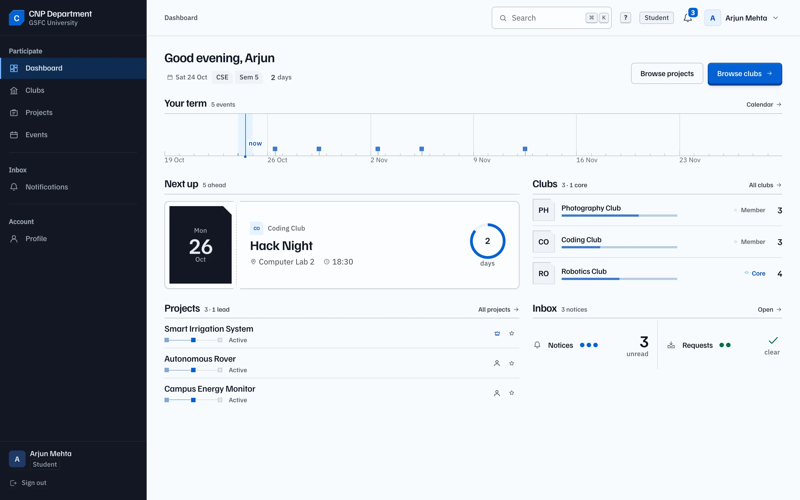<br/><sub><b>Student</b> — the term as a strip, the next event as a ticket, clubs as crests</sub></td>
<td width="50%">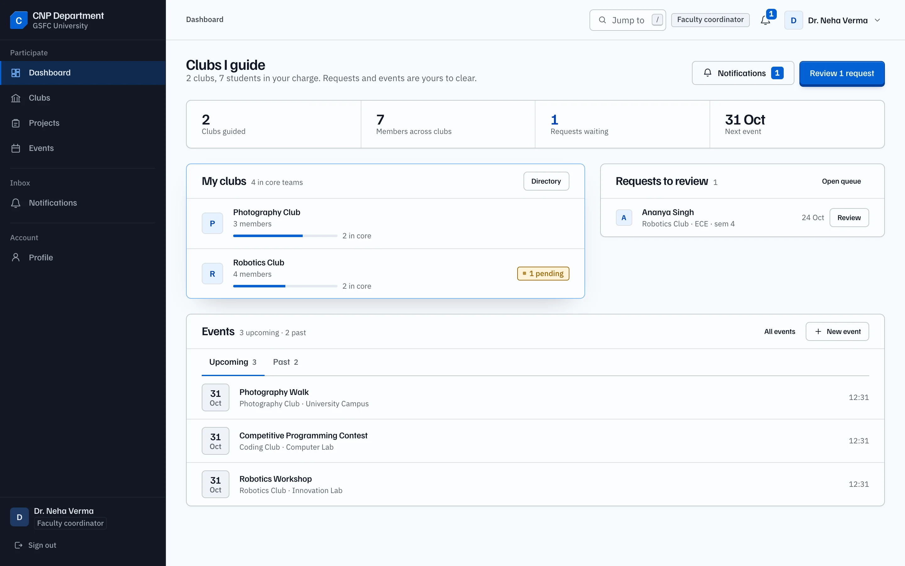<br/><sub><b>Coordinator</b> — the clubs they guide, and the queue as an inbox</sub></td>
</tr>
<tr>
<td>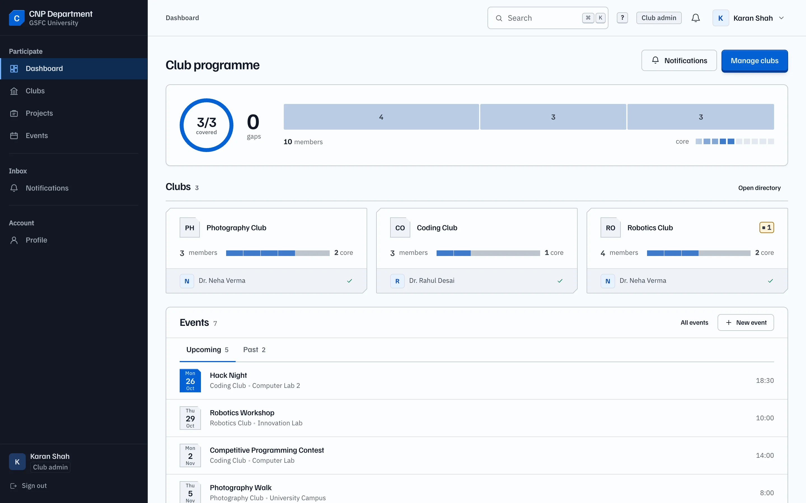<br/><sub><b>Club admin</b> — a coverage map: the empty coordinator slot is the loudest thing</sub></td>
<td><br/><sub><b>Mentor</b> — the constellation: calm, read-mostly, teams as nodes</sub></td>
</tr>
<tr>
<td colspan="2">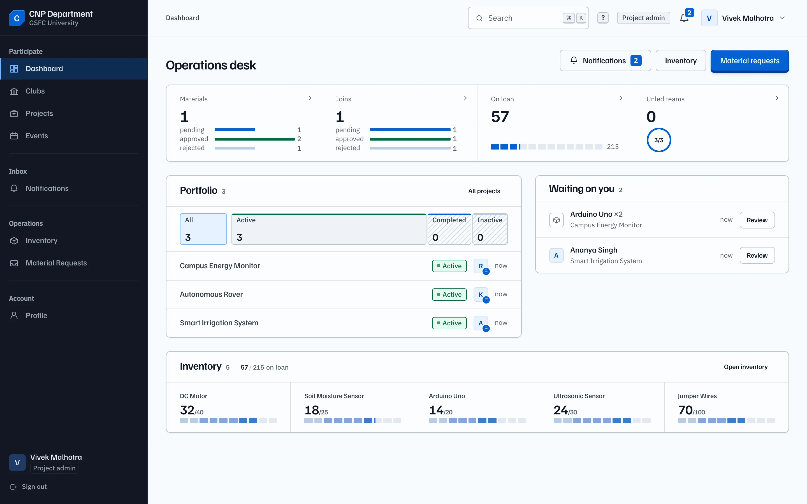<br/><sub><b>Project admin</b> — the console: portfolio blocks, queue depth, inventory as capacity cells</sub></td>
</tr>
</table>

> **Team leader** is not a global role. It is a per-project assignment stored on
> `Project.teamLeaderId`, shown as a mark on the project and in the roster — and enforced as a
> permission, not a label.

---

## The interface

### The command palette

Everything is reachable from the keyboard. <kbd>⌘</kbd><kbd>K</kbd> searches the navigation,
the actions you are allowed to take, and real clubs, projects and events from the API.

<p align="center">
  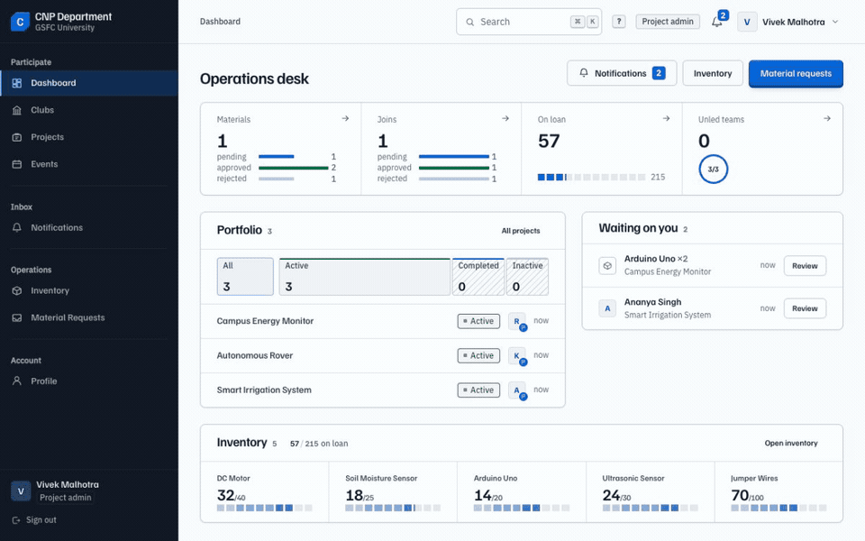
</p>

Press <kbd>?</kbd> for the full map. <kbd>g</kbd> then <kbd>d</kbd>, <kbd>c</kbd>, <kbd>p</kbd>,
<kbd>e</kbd>, <kbd>n</kbd>, <kbd>s</kbd> jumps between areas; <kbd>/</kbd> focuses search.

### Clubs

A club is an identity, not a row of text: a crest, a member stack, a core-team composition bar.
The detail page is the record — members, coordinator, next event, and the administration toolbar
for the people who run it. Joining asks for a seat; leaving is the same door in reverse, confirmed
in place. Core-team seats are released by an administrator, so the page does not offer it.

<table>
<tr>
<td width="50%"><br/><sub><b>Directory</b> — a lead club, then ruled entries with crests</sub></td>
<td width="50%"><br/><sub><b>Club record</b> — members, composition, next up</sub></td>
</tr>
</table>

<p align="center">
  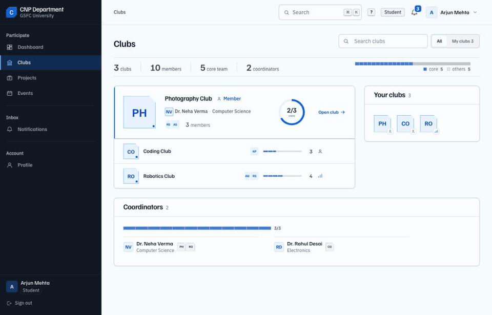
</p>

### Projects

A portfolio sorted by what the project is doing, not by when it was created. The record carries the
team, the mentors, the materials, an updates timeline and the requests in flight.

<table>
<tr>
<td width="50%">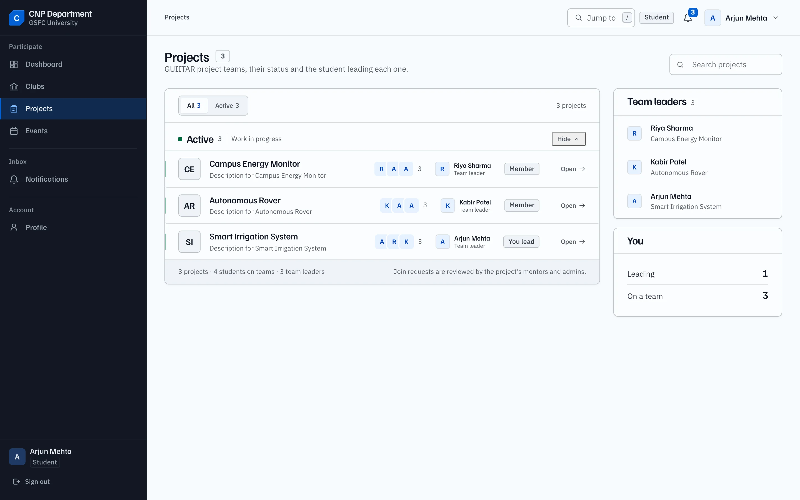<br/><sub><b>Portfolio</b> — status groups, team, leader, your standing</sub></td>
<td width="50%">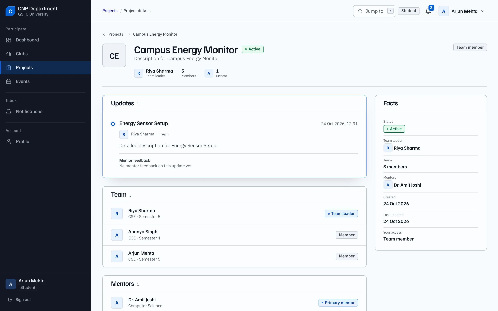<br/><sub><b>Project record</b> — updates, team, mentors, facts</sub></td>
</tr>
</table>

### Events

The calendar is the page: a month you can read at a glance, a selected day you can open, and an
agenda for the term. Creation is a modal over the calendar.

<p align="center">
  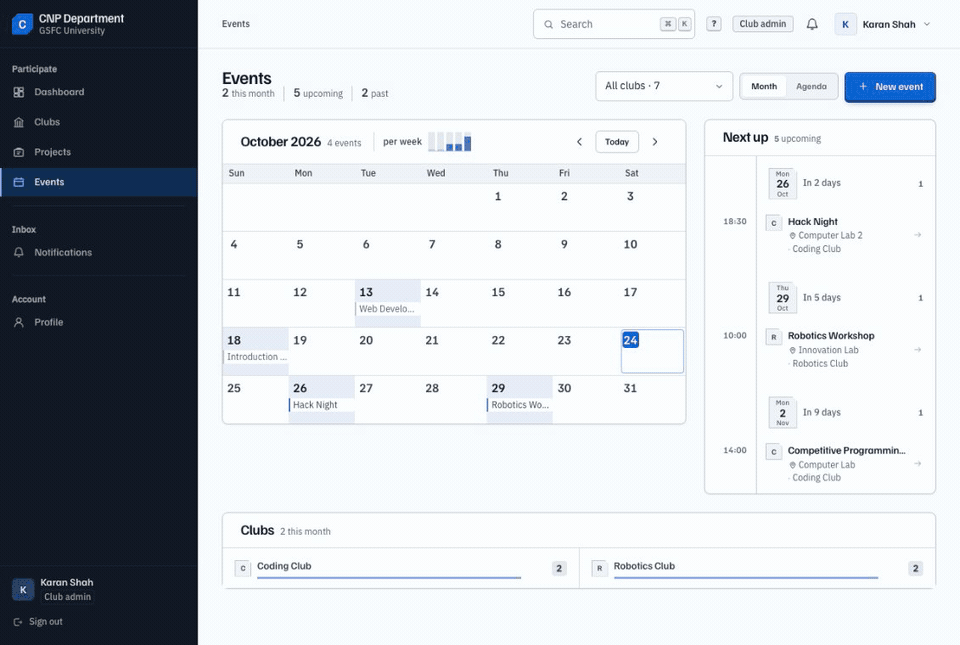
</p>

<p align="center">
  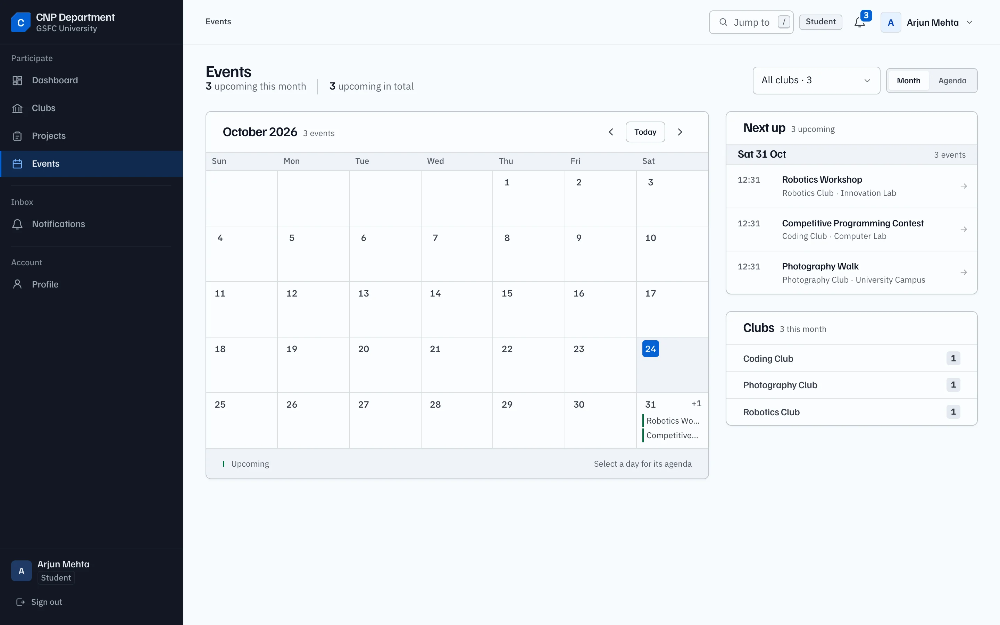
</p>

### The inbox

Notifications are a mail client, not a card wall: day groups on the left, the full record with its
facts and quote on the right, unread carried by a mark and a weight rather than colour alone.
Read state is two-way — a row can go back to unread, because an inbox you can only empty is not a
filing system.

<p align="center">
  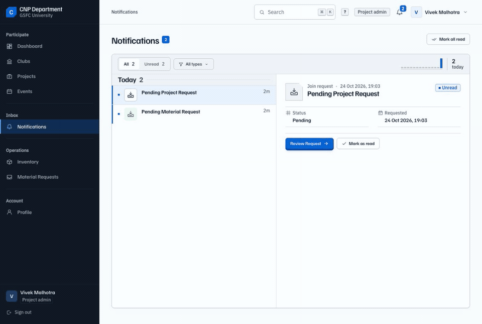
</p>

<p align="center">
  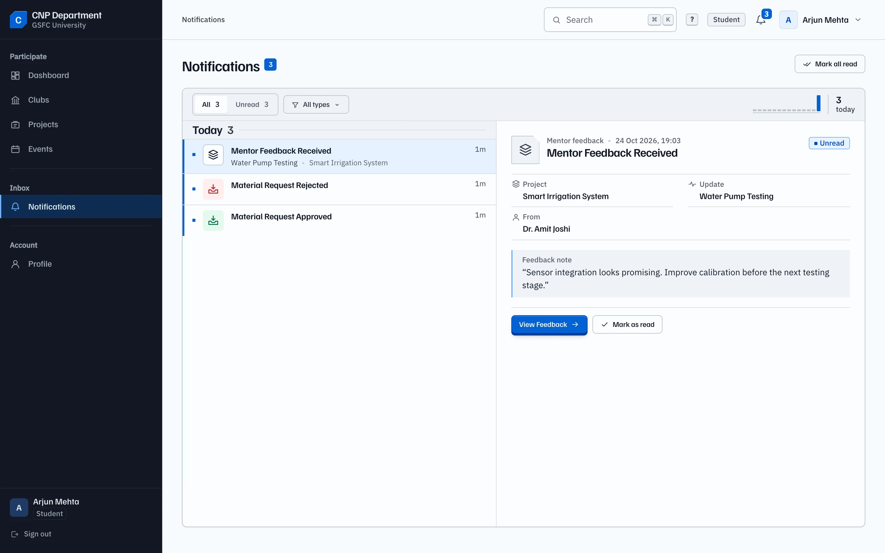
</p>

### Operations

Two screens for the people who keep the labs running: the store room as a stock surface with
capacity, and the request queue as a pipeline with a guarded approve/reject.

<table>
<tr>
<td width="50%">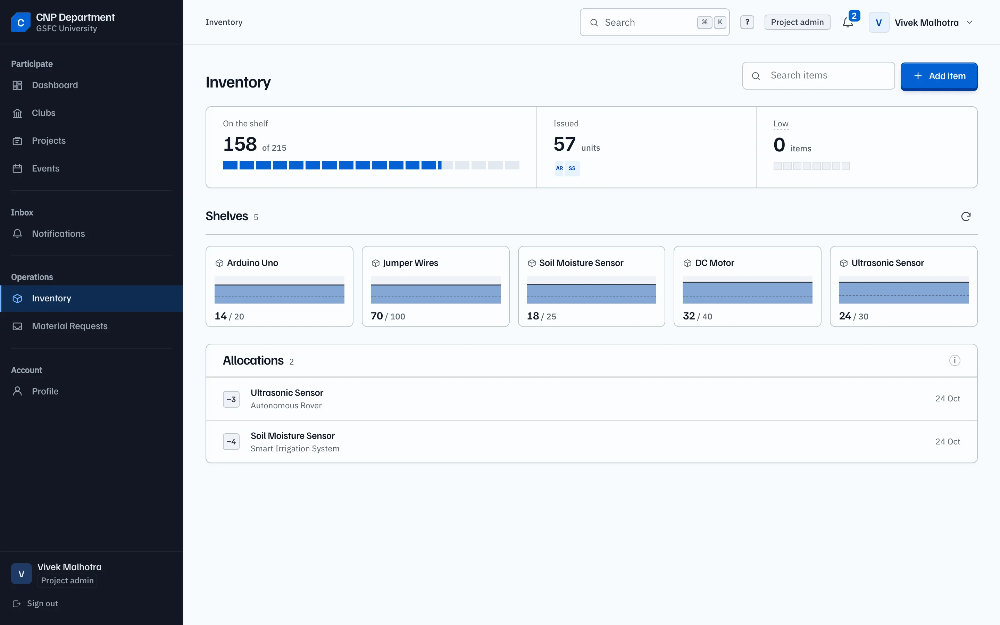<br/><sub><b>Inventory</b> — stock, allocations, low-stock signal</sub></td>
<td width="50%"><br/><sub><b>Requests</b> — what needs a decision now, resolved below</sub></td>
</tr>
</table>

### Administration

Every destructive action is a styled confirmation with the same guard conditions as before — no
`window.confirm`, no lost capability.

<p align="center">
  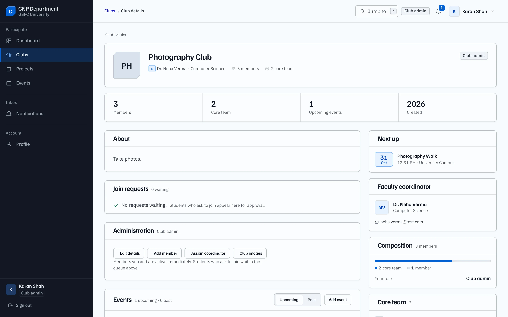
  <br/><sub><b>Club administration</b> — requests, members, coordinator, imagery, one toolbar</sub>
</p>

<p align="center">
  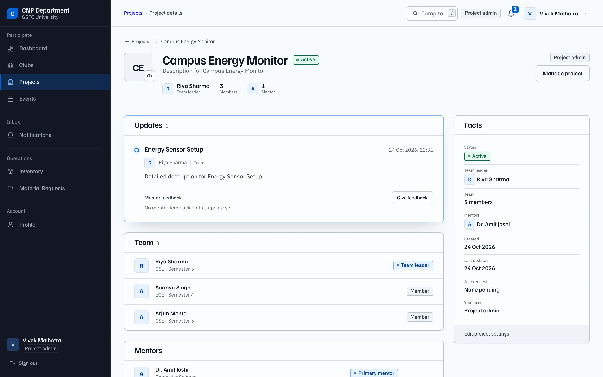
  <br/><sub><b>Project administration</b> — settings, team, materials and mentors in one composition</sub>
</p>

### Profile and the public door

<table>
<tr>
<td width="50%"><br/><sub><b>Profile</b> — an identity plate with a completeness ring</sub></td>
<td width="50%">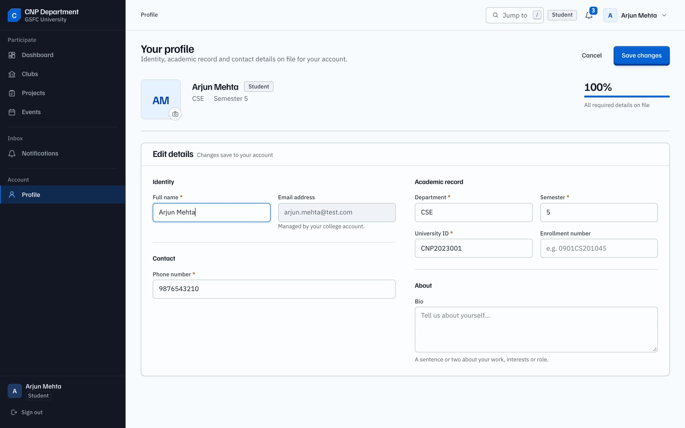<br/><sub><b>Edit</b> — one sheet, two postures</sub></td>
</tr>
<tr>
<td>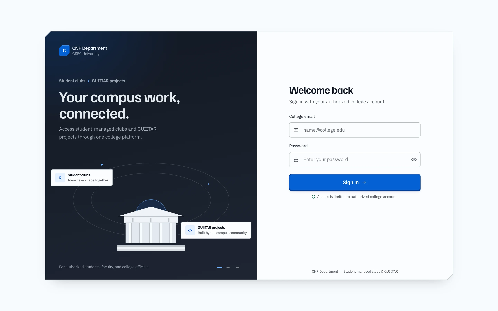<br/><sub><b>Sign in</b> — the brand anchor, now in Cobalt</sub></td>
<td>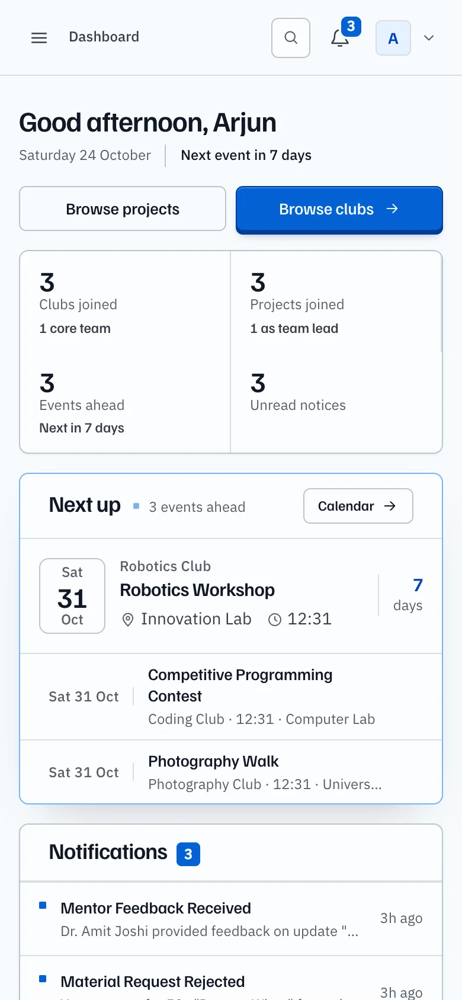<br/><sub><b>Mobile</b> — the rail becomes a drawer, the page one column</sub></td>
</tr>
</table>

---

## Design system · Cobalt

One visual language across the public page and the signed-in app.

| | |
|---|---|
| **Paper** | cool near-white `oklch(98.6% 0.005 250)`, white sheets on top |
| **Ink** | blue-black `oklch(21% 0.028 262)`, secondary grey-blue |
| **Signal** | one electric cobalt `oklch(52% 0.19 258)` — action, active, selection. Nothing else is blue |
| **Status** | positive / warning / negative, always paired with a word or a mark |
| **Type** | Familjen Grotesk for titles, names and numbers; IBM Plex Sans for everything else |
| **Form** | hairlines over shadows, cut corners on signature objects, tabular numerals |
| **Density** | a five-step glyph ramp for heat and rank; accent is a signal, never a series colour |
| **Motion** | 120–460 ms transitions that confirm a pointer or a state change; one entrance choreography per page |

**Everything is a token.** `frontend/src/tokens.css` holds every colour, space, radius, shadow and
duration; no component writes a literal. Four layers sit on top:

| Layer | Role |
|---|---|
| `frontend/src/ui.css` | the signed-in primitive layer — keys, panels, ruled rows, tables, tags, fields, tabs, stats, menus, modals, empty and skeleton states |
| `frontend/src/components/ui/vis.css` | **the instruments** — rings, sparklines, ranked bars, density grids, avatar stacks, date tiles, segmented meters, glyphs |
| `frontend/src/components/ui/chrome.css` | the command palette, tooltips and the shortcuts sheet |
| `frontend/src/landing.css` + `base.css` | the public page |

Pages compose these and add layout only, which is why eight screens built in parallel still read as
one product.

**Information as form.** The house rule is that a sentence describing data is a failure to draw it.
"2 events this week, next in 7 days" becomes a week strip with two filled cells and a marked next.
"42 members, 8 in the core team" becomes an avatar stack and a segmented bar. Anything that cannot
be drawn moves into a tooltip or a hover inspector — never into a paragraph.

**Accessibility is the floor, not a pass.** Visible `:focus-visible` on every control, real
`<button>`/`<a>` semantics, `aria-pressed` / `aria-expanded` / `aria-current`, `role="img"` with a
name on every data visual, Escape to close overlays with focus returned to the trigger, labelled
inputs, 4.5:1 body contrast, and a `prefers-reduced-motion` guard in every stylesheet.

---

## How it is built

| Layer | Choice |
|---|---|
| Frontend | React 19, TypeScript 6, Vite 8, React Router 7 — no UI kit, no CSS framework, no chart library |
| Styling | CSS custom properties + one stylesheet per surface; data visuals are hand-authored SVG and CSS |
| Backend | Express 5, Mongoose 8, JWT bearer auth, Cloudinary for uploads |
| Data | MongoDB — users, clubs, memberships, projects, mentors, events, notifications, join requests, inventory, allocations, material requests |
| Icons | hand-drawn inline SVG on a 24 px grid, 1.7 stroke. No icon dependency, no emoji |
| Tests | Vitest + Testing Library (frontend), Vitest + Supertest + in-memory Mongo (backend) |

```
frontend/src
├── pages/             one folder per area, each with its own stylesheet
│   ├── Landing/       the public page
│   ├── Dashboard/     role router + five role dashboards
│   ├── Clubs/         directory + club record
│   ├── Projects/      portfolio + project record
│   ├── Events/        calendar, agenda, detail, form
│   ├── Notifications/
│   ├── Inventory/     + MaterialRequests/
│   ├── Profile/
│   └── Auth/          sign in + student sign-up
├── components/
│   ├── layout/        the shell: rail, header, drawer, route rail
│   ├── ui/            instruments (vis), chrome (palette, tooltips, shortcuts)
│   ├── landing/       nav, hero, sections, close, footer
│   └── clubs/ · projects/ · events/ · dashboard/
├── ui.css             the signed-in primitive layer
├── tokens.css         the only source of colour, space, type, motion
└── services/api.ts    the typed API client

backend
├── server.js          the app + route mount map
├── src/routes/        auth, clubs, projects, join requests, mentors, updates,
│                      events, materials, inventory, allocations, notifications
├── src/models/        16 Mongoose schemas
├── src/services/      notifications, event reminders, Cloudinary
├── src/lib/http.js    query parsing, cursors, error mapping
├── scripts/           backfill + smoke
└── tests/             278 tests over 15 files
```

**Navigation.** The shell is mounted once. A route change swaps the page inside it, runs a 2 px
cobalt rail at the top of the viewport while the destination fetches, and fades the incoming
content 4 px. There is no full-page loader after the first paint.

**Data flow.** Pages call `api<T>(method, endpoint, body?)`; the JWT lives in `localStorage` and is
attached as `Authorization: Bearer`. A `401` clears the token and signals the shell, so an expired
session becomes a clean sign-out instead of a dead screen. Every page owns its loading, empty, error
and success states.

**Freshness.** There is no cache layer by design. Summaries are aggregated server-side; lists are
filtered and paginated server-side where the volume warrants it.

---

## Run it locally

**Prerequisites:** Node 20+, MongoDB (local or Atlas), and a Cloudinary account for uploads.

```bash
# 1 · backend
cd backend
npm install
cp .env.example .env        # MONGODB_URI, JWT_SECRET, CLOUDINARY_*
npm run seed                # demo data: clubs, projects, events, requests
npm run dev                 # http://localhost:5001

# 2 · frontend
cd frontend
npm install
cp .env.example .env        # VITE_API_URL=http://localhost:5001/api
npm run dev                 # http://localhost:5173
```

### Demo accounts

Created by `npm run seed`. The password for all of them is `Test@12345`.

| Role | Email | Opens with |
|---|---|---|
| Student | `arjun.mehta@test.com` | their term, memberships, inbox |
| Faculty coordinator | `neha.verma@test.com` | two clubs and a request queue |
| Faculty mentor | `amit.joshi@test.com` | mentored projects and feedback |
| Club admin | `karan.shah@test.com` | the club programme and its gaps |
| Project admin | `vivek.malhotra@test.com` | the console: portfolio, materials, inventory |

> Self-registration creates **students only**. A role is an authorisation claim, so staff accounts
> are provisioned by the department (or by widening `REGISTRATION_ROLES` deliberately).

### Scripts

| Where | Command | What it does |
|---|---|---|
| `frontend/` | `npm run dev` | Vite dev server |
| `frontend/` | `npm run build` | typecheck + production build |
| `frontend/` | `npm test` | the frontend suite |
| `frontend/` | `npm run test:coverage` | suite + V8 coverage |
| `backend/` | `npm run dev` | Node watch mode |
| `backend/` | `npm start` | production server |
| `backend/` | `npm run seed` | reset the demo data |
| `backend/` | `npm test` | the API suite (in-memory Mongo, no server needed) |
| `backend/` | `npm run test:coverage` | suite + coverage |
| `backend/` | `npm run backfill` | idempotent migration for the new schema fields |

---

## Tests

**375 tests, green.** The suites exist to protect the things that are expensive to get wrong:
authorisation, money-like inventory arithmetic, and the state machines behind join and material
requests.

| Suite | Tests | Coverage | What it locks down |
|---|---|---|---|
| `frontend/` | **97** | 95.2 % statements · 98.1 % lines | the API client (headers, `ApiError`, 401 recovery), profile completeness, auth context, guards, event partitioning, tooltip behaviour, the sign-in form |
| `backend/` | **278** | 73.4 % statements · 83.1 % functions | the role matrix per route, join-request and material-request workflows, stock arithmetic, notification ownership, response envelopes, validation and error mapping |

```bash
cd backend  && npm test     # 278 passed · ~23s
cd frontend && npm test     #  97 passed ·  ~6s
```

The backend suite runs against a **real in-memory MongoDB**, not a stub, so unique indexes,
`$lookup` aggregations and atomic `findOneAndUpdate` claims behave exactly as in production. The
frontend suite stubs `fetch` and never touches the network.

The suites have already paid for themselves — they found a race in join-request approval, a stale
status in the reject response, an unimported `deleteAsset` that orphaned uploads, and an expired
token that was never cleared. All four are fixed and covered.

See [`docs/testing.md`](docs/testing.md) for the strategy and [`backend/tests/README.md`](backend/tests/README.md)
for the API suite's structure.

---

## Backend engineering

The API was hardened in the same pass as the interface. The full record — every bug, every
decision, every index — is in **[`docs/backend-changes.md`](docs/backend-changes.md)**.

Highlights:

- **Race conditions closed.** Approving a join request was check-then-create; two reviewers could
  both create a membership. Transitions are now atomic claims, with partial unique indexes as the
  backstop.
- **Stock can no longer drift.** Material approval deducts stock and creates the allocation with
  compensation on failure; inventory deletion is blocked while allocations or requests reference
  the item.
- **95 % of the "500s" were malformed input.** Every `catch` now maps CastError and ValidationError
  to `400` and never leaks a Mongo message.
- **Aggregates moved to the server.** `/clubs/summary`, `/projects/summary`, `/inventory/summary`,
  `/material-requests/summary`, `/events/summary` and `/dashboard/summary` replace client-side sums.
- **Filters and search** (`q`, `status`, `scope`, `mine`, `month`, cursors) on every collection the
  UI used to narrow in the browser.
- **Four N+1 patterns removed**, ~25 indexes added, `.lean()` and field projections on read paths.
- **Missing verbs added:** mark a notification unread, leave a club or project, bulk approve/reject
  material requests atomically.

What is still derived on the client is documented, with the endpoint that would replace it, in
[`docs/backend-mocks.md`](docs/backend-mocks.md). Nothing in that list is faked in the UI.

---

## Routes

| Route | Access | Screen |
|---|---|---|
| `/` | public | landing page |
| `/login`, `/register` | public | authentication, student sign-up |
| `/dashboard` | signed in | role-specific dashboard |
| `/clubs`, `/clubs/:id` | signed in | directory, club record |
| `/projects`, `/projects/:id` | signed in | portfolio, project record |
| `/events` | signed in | calendar, agenda, detail |
| `/notifications` | signed in | inbox |
| `/profile` | signed in | profile record and form |
| `/inventory` | project admin | stock and allocations |
| `/material-requests` | project admin | request pipeline |

Incomplete student profiles are redirected to `/profile` until the university ID and semester are
set. `ProtectedRoute` handles authentication; `RoleProtectedRoute` handles the two operations
routes; the API re-checks every role on every request.

---

## Documentation

| Document | What is in it |
|---|---|
| [`docs/backend-changes.md`](docs/backend-changes.md) | every backend bug fixed, every endpoint added, schema changes, index rationale, trade-offs |
| [`docs/backend-mocks.md`](docs/backend-mocks.md) | what the UI still derives client-side, and the endpoint that would replace it |
| [`docs/testing.md`](docs/testing.md) | the test strategy, stack choices, coverage, and gaps |
| [`docs/redesign-brief.md`](docs/redesign-brief.md) | the design contract: tokens, primitives, page anatomy, accessibility floor |
| [`docs/visual-pass.md`](docs/visual-pass.md) | the instrument rule: text budget, box budget, motion, visual grammar |
| [`docs/mocks/`](docs/mocks) | per-area detail behind the wiring backlog |
| [`AGENTS.md`](AGENTS.md) | repository conventions for contributors and agents |

---

## Roadmap

In rough order of value:

1. **Pagination in the UI.** The API supports cursors and limits; the lists are still full fetches.
2. **Server-side search index.** `GET /search` uses regex today; Atlas Search would make the
   command palette instant at any scale.
3. **Transactions.** Multi-document workflows use atomic claims plus compensation; a replica set
   would let them be true transactions.
4. **Asset lifecycle.** A periodic sweep for uploads orphaned before the `deleteAsset` fix.
5. **Notification digests.** The reminder scheduler runs daily; a weekly summary mail is the
   natural next step.
6. **Prune the legacy stylesheet.** `app.css` still carries the pre-redesign sheet; the login page
   was the last consumer and has moved to its own file.

---

<p align="center"><sub>Built at GSFC University, Vadodara · Student Managed Clubs &amp; GUIITAR Projects</sub></p>
